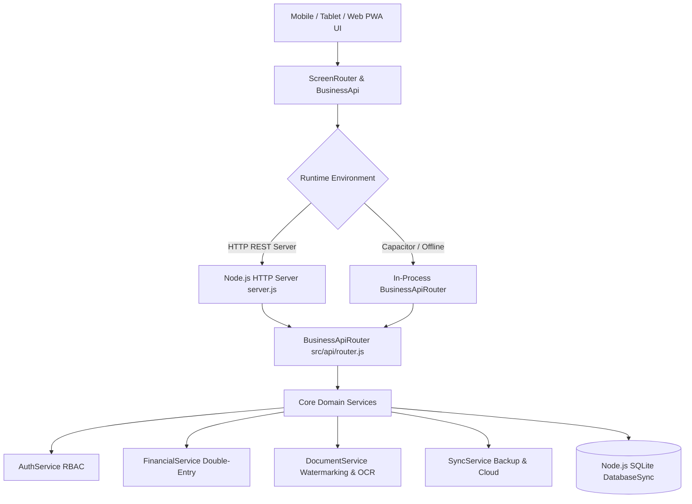
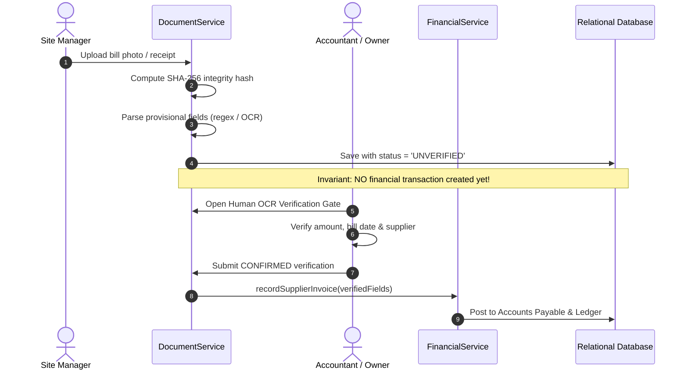

# DDevUltraHome — System Architecture & Platform Specification

> **D DEV ULTRA HOMES**  
> *Tagline: "Building your dreams"*  
> **Platform Version:** 1.0.0 (Foundation Milestone)  
> **Target OS:** Android Native (Capacitor) & Modern Web PWA  
> **Region:** Tamil Nadu, India  

---

## 1. Executive Summary & Product Vision

**DDevUltraHome** is an Android-first, offline-capable construction business management platform designed specifically for:
- **Construction Business Owners & Managing Directors**
- **Senior & Site Accountants**
- **Site Managers & Project Supervisors**
- **Civil & Structural Engineers**
- **Authorized Clients & Property Developers**

### Core Philosophy
DDevUltraHome is **NOT** merely a civil engineering calculator. Its primary mission is to unify multiple construction projects, client contracts, project expenses, material purchases, payments, supplier dues, quotations, construction progress, client reports, and reliable cloud backups in one cohesive application.

---

## 2. Non-Negotiable Financial Accounting & Business Rules

| Rule | Business Invariant | Technical Implementation |
|---|---|---|
| **Rule 1: Client Advances** | Client advances are **unearned liability deposits**, NEVER treated as profit or earned revenue until milestone certification. | Stored in `client_receipts` with `is_advance = 1` and tracked via `unallocated_balance`. Only `allocateAdvanceToMilestone()` transfers liability into earned revenue. |
| **Rule 2: Accounts Payable** | Unpaid supplier invoices are **payables**, NEVER treated as cash payments. | `recordSupplierInvoice()` increments `suppliers.outstanding_dues` and sets `supplier_invoices.payment_status = 'UNPAID'` with zero change to bank or cash ledger. |
| **Rule 3: Cash Outflow** | Cash or bank balances only decrease when explicit supplier payments or direct expenses are recorded. | `recordSupplierPayment()` and `recordExpense()` deduct from `financial_accounts` and validate balance sufficiency (`insufficient balance` guard). |
| **Rule 4: Human OCR Gate** | Raw OCR extractions from bills, invoices, or delivery challans are strictly provisional and UNVERIFIED. | New OCR scans are flagged `UNVERIFIED` in `ocr_reviews`. Only authorized roles (`OWNER` or `ACCOUNTANT`) can verify and confirm amounts before posting transactions. |
| **Rule 5: Data Truth** | Bundled rates are marked as bundled benchmarks; cloud providers are only marked connected when real network checks succeed. | Real SHA-256 data hash computed on all backups; sync status accurately reflects genuine provider health. |

---

## 3. Technology Architecture & Stack



### Stack Highlights
1. **Engine & Persistence:**
   - **Node.js 22+ Pure ESM** with built-in `node:sqlite` (`DatabaseSync`).
   - Zero external C++ or npm database dependencies.
   - Enforced foreign keys (`PRAGMA foreign_keys = ON;`) and WAL mode for high concurrency.
   - Nested transactions supported via automatic `SAVEPOINT` generation.
2. **Mobile Framework:**
   - **Capacitor 8** (`@capacitor/android`, `@capacitor/core`, `@capacitor/cli`).
   - Clean WebView wrapper with native Android back-button handling, safe-area insets, and offline cache.
3. **Design System:**
   - Deep Construction Navy (`#0B192C`, `#1E3E62`) with Royal Gold Accent (`#D97706`, `#F59E0B`).
   - Mobile-first touch targets ($\ge 48\text{px}$).
   - Status indicators: Emerald (Paid/Active), Indigo (Advance Liability), Rose (Accounts Payable), Amber (Pending Review).

---

## 4. Relational Database Schema & Migrations

The database framework uses atomic sequential versioned migrations (`_schema_migrations` tracking table):

### Table Manifest (23 Relational Tables)
1. **`company_settings`**: Corporate identity, branding, GSTIN, PAN, and currency settings.
2. **`users`**: System users, PBKDF2/SHA-256 password hashes, phone, and RBAC roles.
3. **`clients`**: Client profiles, billing addresses, GSTIN, and contact details.
4. **`projects`**: Project codes, contracts, site addresses, districts, budgets, and status.
5. **`contracts`**: Formal project agreements, payment terms, advance %, and retention %.
6. **`project_budgets`**: Itemized cost baselines per project.
7. **`budget_variations`**: Scope change orders and approved budget revisions.
8. **`quotations`**: Versioned customer estimates (`QUOT-XXXXX`).
9. **`quotation_items`**: Line items with unit rates, quantities, and descriptions.
10. **`suppliers`**: Material vendors, categories, and live `outstanding_dues`.
11. **`financial_accounts`**: Bank accounts, escrow accounts, and site petty cash registers.
12. **`client_receipts`**: Cash inflows distinguishing advances from earned milestone billings.
13. **`receipt_allocations`**: Double-entry allocation connecting unearned advances to certified milestones.
14. **`supplier_invoices`**: Material bills received with taxable subtotal, GST, and balance dues.
15. **`supplier_payments`**: Outgoing payments decreasing supplier dues and bank balance.
16. **`expenses`**: Direct site expenses (labour, equipment, freight, petty cash).
17. **`account_transactions`**: Double-entry ledger of all credits, debits, and balance after.
18. **`milestones`**: Construction payment milestones with target % and billable amounts.
19. **`progress_updates`**: Daily site logs with weather, workforce headcount, and stage completion.
20. **`documents`**: Document vault metadata with cryptographic SHA-256 hash.
21. **`ocr_reviews`**: Provisional OCR bill extractions and human confirmation audit records.
22. **`audit_logs`**: Tamper-evident corporate change ledger.
23. **`sync_state`**: Backup snapshots, cloud sync status, and SHA-256 data verification.

---

## 5. Role-Based Access Control (RBAC) Matrix

| Entity / Action | OWNER | ACCOUNTANT | SITE_MANAGER | ENGINEER | CLIENT |
|---|:---:|:---:|:---:|:---:|:---:|
| **Company Settings & Accounts** | Full | Read Only | No Access | No Access | No Access |
| **All Projects & Contracts** | Full | Read / Update | Read (Assigned) | Read (Assigned) | Read (Own Only) |
| **Client Invoicing & Receipts** | Full | Full | Read Only | No Access | Read (Own Only) |
| **Allocate Advances to Milestones** | Full | Full | No Access | No Access | No Access |
| **Supplier Invoices & Payables** | Full | Full | Log Only | No Access | No Access |
| **Supplier Payments & Bank Disbursals** | Full | Full | No Access | No Access | No Access |
| **Site Expenses & Petty Cash** | Full | Full | Log Payouts | No Access | No Access |
| **Human OCR Gate Verification** | Full | Full | No Access | No Access | No Access |
| **Site Daily Logs & Progress** | Full | Read Only | Full | Full | Read Only |
| **Engineering Calculations Hub** | Full | Read Only | Read Only | Full | Read Only |
| **Database Snapshot Export & Sync** | Full | Full | No Access | No Access | No Access |

---

## 6. The 12 Modular Application Screens

1. **Executive Dashboard (`dashboardScreen.js`)**:
   - Liquid Cash & Bank Funds (`₹`)
   - Accounts Payable / Supplier Dues (`₹`)
   - Unearned Client Advance Liabilities (`₹`)
   - Net Operating Cashflow (`₹`)
   - Active Sites, Total Clients, Pending Bills, and Quick Actions.
2. **Projects Directory (`projectsScreen.js`)**:
   - Active, Planning, and Completed project list.
   - New Project creation modal with client dropdown and budget constraints.
   - Detailed project financial summary with one-click P&L inspection.
3. **Clients Directory (`clientsScreen.js`)**:
   - Customer portfolio, corporate entity names, and contact records.
   - Aggregate project count and cumulative contract value.
   - New client registration modal with GSTIN and PAN validation.
4. **Quotations & Proposals (`quotationsScreen.js`)**:
   - Multi-revision estimate generator with draft, sent, and approved statuses.
   - Itemized unit rate calculation for civil works.
5. **Income & Advance Receipts (`incomeScreen.js`)**:
   - Client receipts directory with payment mode and bank deposit tracking.
   - Explicit advance liability designation (`is_advance = 1`).
   - Unallocated advance balance vs allocated milestone revenue.
6. **Expenses & Site Purchases (`expensesScreen.js`)**:
   - Categorized site expenses: Labour, Materials, Equipment, Transport, Petty Cash.
   - Real-time bank/cash balance validation before disbursement.
7. **Suppliers & Accounts Payable (`suppliersScreen.js`)**:
   - Vendor directory organized by trade (Steel, Cement, RMC, Bricks, Electrical).
   - Invoicing and live outstanding dues aging.
   - Supplier payment recording dialog.
8. **Progress Tracking & Site Logs (`progressScreen.js`)**:
   - Contract payment milestones with target completion %.
   - Daily site logs reporting workforce headcount, weather, and delays.
9. **Documents & OCR Human Review Gate (`documentsScreen.js`)**:
   - Corporate vault with cryptographic SHA-256 hash tracking.
   - Dynamic SVG watermark generator with diagonal corporate branding.
   - Interactive human verification modal for provisional OCR scans.
10. **Reports & P&L Statement (`reportsScreen.js`)**:
    - Project-specific Profit & Loss statement.
    - True revenue recognition formula: $\text{Earned Revenue} - (\text{Direct Expenses} + \text{Supplier Bills})$.
    - Net operating margin calculation.
11. **Backup & Cloud Sync (`backupScreen.js`)**:
    - Offline JSON snapshot generator and browser downloader.
    - SHA-256 hash verification on export and restoration.
    - Cloud sync adapter status for Google Drive API and Supabase Cloud.
12. **Settings & Governance (`settingsScreen.js`)**:
    - D DEV ULTRA HOMES corporate profile.
    - Registered bank and escrow accounts overview.
    - Real-time active role switcher for instant permission simulation.

---

## 7. Document Watermarking & Human OCR Gate



---

## 8. Verification & Automated Test Suite

The test suite contains **156 passing tests across 41 test suites** running natively in Node.js 22+:

- `test/migrations.test.js`: Validates atomic sequential schema migrations and foreign keys.
- `test/rbac.test.js`: Validates RBAC permissions and session token authentication.
- `test/financial.test.js`: Validates unearned advances, accounts payable, and P&L math.
- `test/ocr_review_gate.test.js`: Validates SHA-256 hashes, watermarks, and mandatory human review gate.
- `test/backup_sync.test.js`: Validates immutable JSON snapshots and cloud sync adapters.
- `test/api_router.test.js`: Validates unified REST and in-process API endpoints.
- `test/business_screens.test.js`: Validates 12 screen modules and design system tokens.
- `test/mobile_ui_redesign.test.js`: Validates navigation, responsive layout, and bilingual integrity.
- Engineering and price intelligence suites: 100+ tests verifying civil engineering calculations, Tamil Nadu PWD SOR rates, and scrap valuations.

Run tests:
```bash
pnpm test
```

---

## 9. Android Build & CI/CD Pipeline

The GitHub Actions workflow (`.github/workflows/build-apk.yml`) automates Android APK compilation:
1. Checks out repository on `main` and `feature/**` branches.
2. Sets up Node.js 22 and Java 21 (Temurin JDK).
3. Executes pre-build automated tests (`pnpm test`).
4. Generates Android icons using official D DEV ULTRA HOMES brand assets.
5. Synchronizes Capacitor web assets (`pnpm exec cap sync android`).
6. Assembles debug APK with Gradle (`./gradlew assembleDebug`).
7. Uploads verified artifact `DDevUltraHome-Debug-APK`.
